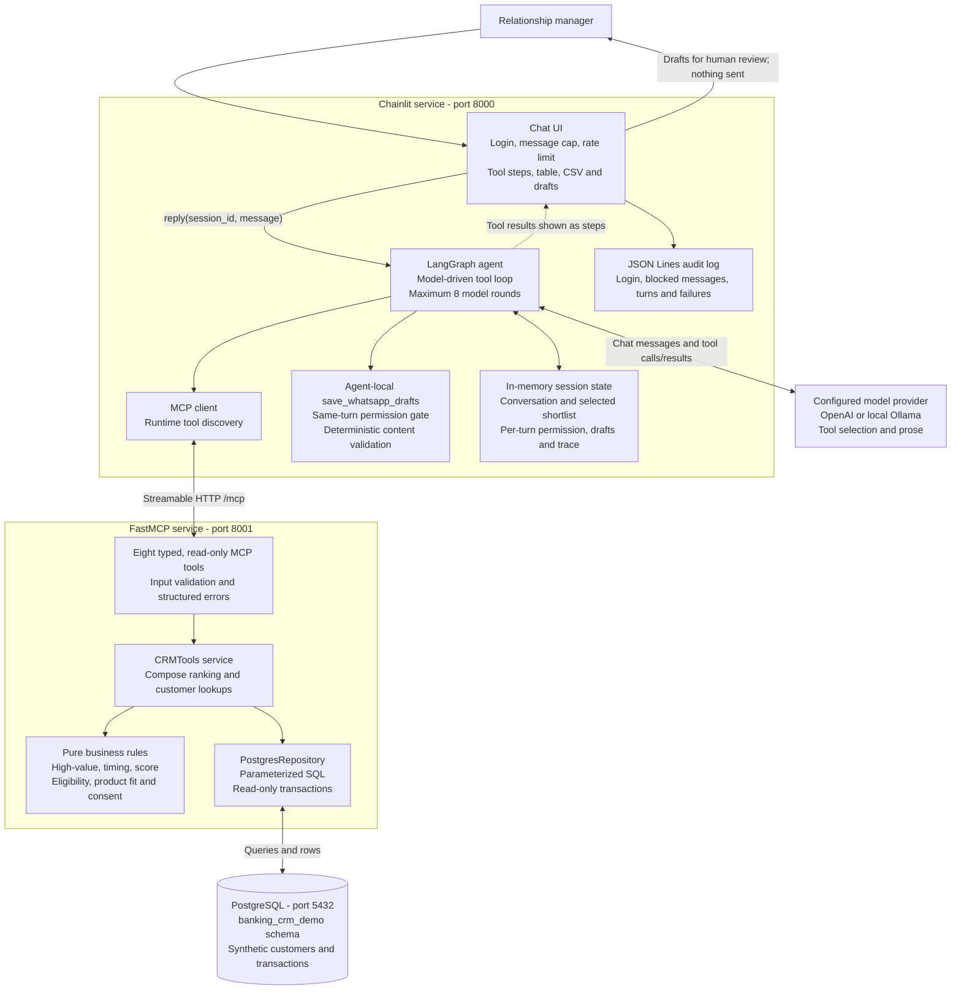

# Architecture diagram

[Setup and run](../README.md) · [Architecture guide](../docs/architecture.md) · [Process flow](process_flow.md) · [Database diagram](database_diagram.md)

## Boundaries and responsibilities

- **Model versus rules:** the model chooses tools and writes prose; deterministic code calculates scores, eligibility and permission. Customer financial figures are returned to the model and UI as bands. There is no agent-generated SQL.
- **Tool server versus agent-local draft tool:** database capabilities live behind MCP. Draft acceptance lives in the agent because it depends on permission confirmed within the current turn. Drafts live in graph state and are included in the audit record; no message-sending integration exists.
- **Session versus turn:** the in-memory checkpointer uses `session_id` as the thread key. Conversation messages and the selected shortlist persist across turns; permission, drafts, trace and round count reset on each request. State does not survive a process restart.
- **Network exposure:** Compose binds the database and MCP host ports to `127.0.0.1`; the chat port is published on all host interfaces. The chat requires login, but the MCP endpoint has no authentication. Other containers on the network can reach MCP.
- **Storage:** PostgreSQL uses the `postgres_data` volume; the audit file uses `audit_logs`. Conversation state is in memory rather than either volume.

See [design decisions and limitations](../docs/design-decisions.md) for alternatives and production gaps.
