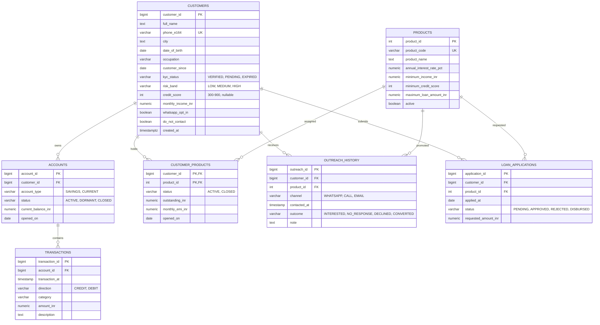

# Database Diagram

[Setup and run](../README.md) · [Documentation index](../docs/README.md) · [Architecture diagram](architecture_diagram.md) · [Process flow](process_flow.md)

Schema: `banking_crm_demo`

Views (not shown in the diagram): `customer_features`, `personal_loan_prospects`.

Transaction categories: regular `SALARY`, `BUSINESS_INCOME`, `RENT`, `SHOPPING`, `UTILITIES`, `TRANSFER`, `LOAN_EMI`, plus one-off life events `EDUCATION`, `MEDICAL`, `TRAVEL`, `HOME_IMPROVEMENT`, `WEDDING` (the signals behind `get_transaction_insights`).
