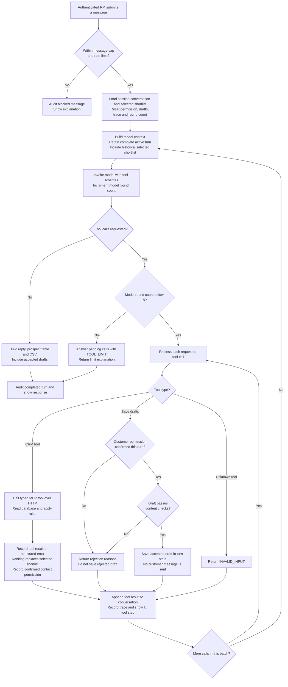
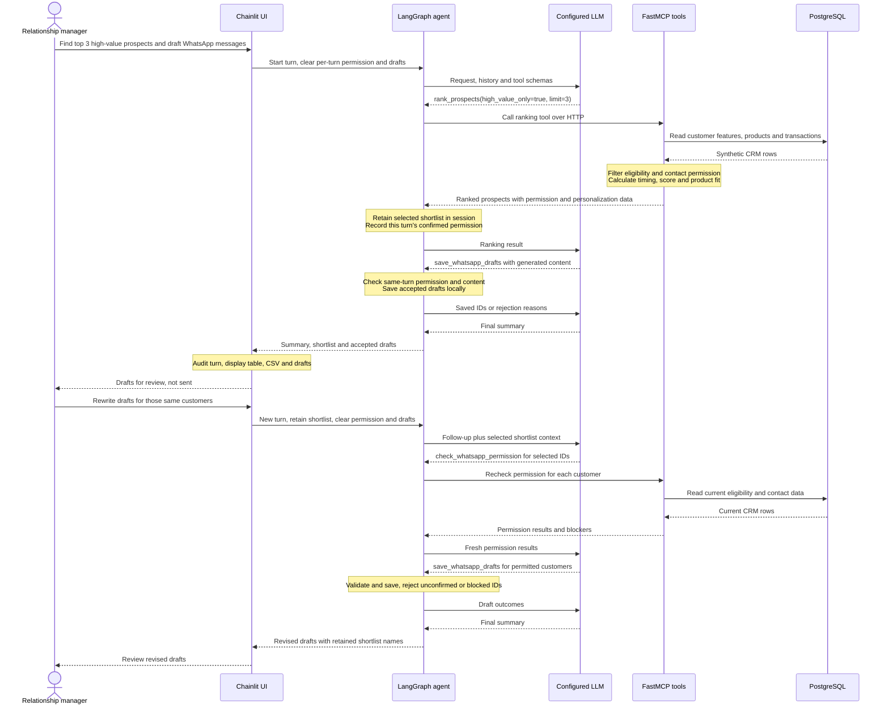

# Process flow

[Setup and run](../README.md) · [Architecture guide](../docs/architecture.md) · [Architecture diagram](architecture_diagram.md)

## One chat turn

The model chooses tools and their order. This diagram shows the orchestration and enforcement boundaries, rather than a fixed sequence of tool calls.

A rejected draft is returned to the model with reasons so it can rewrite within the remaining rounds. Errors from a tool are also returned to the model. Provider failures and unexpected turn failures are caught by Chainlit, audited as failed turns, and shown as error messages; they do not produce a successful-turn record.

## Main campaign and follow-up

This is the efficient expected path, not a hardcoded workflow: the model can request more detail, retry rejected drafts, or answer a single-customer question using other tools. A ranking already contains timing, product fit and permission, so duplicate lookups are unnecessary for the initial campaign. Fresh permission checks are required before follow-up drafts, the retained shortlist alone never grants permission.
